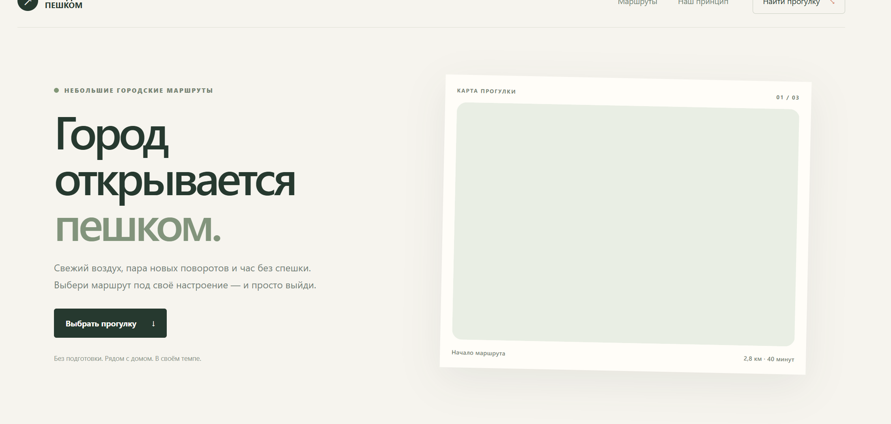
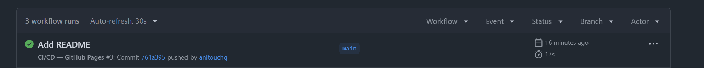
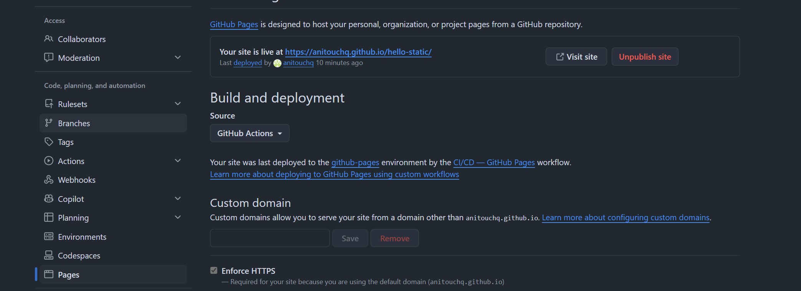

# hello-static

Авторский сайт о городских прогулках на чистых HTML, CSS и JavaScript. GitHub Actions проверяет структуру сайта и JavaScript, затем публикует содержимое каталога `public/` на GitHub Pages.

## Скриншоты

### Сайт

### Успешный запуск GitHub Actions

### Настройки GitHub Pages

## Сайт

[Открыть сайт на GitHub Pages](https://anitouchq.github.io/hello-static/)

## Как работает pipeline

1. Push в `main` или pull request запускает проверки файлов.
2. Проверяется наличие HTML, CSS и JavaScript.
3. Node.js проверяет синтаксис JavaScript, Python проверяет базовую структуру HTML.
4. Каталог `public/` загружается как Pages artifact.
5. После успешного CI отдельный job публикует сайт на GitHub Pages.

Деплой выполняется автоматически при push в `main`; pull request проходит проверки без публикации.

## Структура проекта

| Файл или каталог | Назначение |
|---|---|
| `.github/workflows/ci-cd.yml` | Проверка сайта и деплой на GitHub Pages |
| `public/index.html` | Разметка страниц сайта |
| `public/style.css` | Стили и адаптивная вёрстка |
| `public/script.js` | Интерактивность на JavaScript |
| `screenshots/website.png` | Скриншот опубликованного сайта |
| `screenshots/github-actions.png` | Скриншот успешного workflow |
| `screenshots/github-pages-settings.png` | Скриншот настроек GitHub Pages |
| `README.md` | Описание проекта, pipeline и структуры файлов |

## Результаты

- [GitHub Actions](https://github.com/anitouchq/hello-static/actions)
- [Настройки GitHub Pages](https://github.com/anitouchq/hello-static/settings/pages)

[Главный каталог CI/CD проектов](https://github.com/anitouchq/CI-CD-Pipelines)
